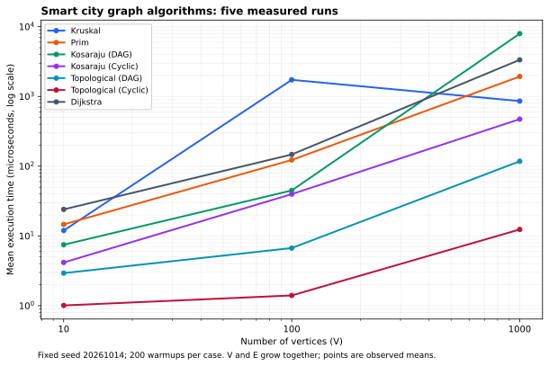
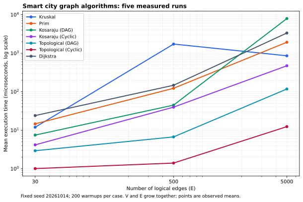
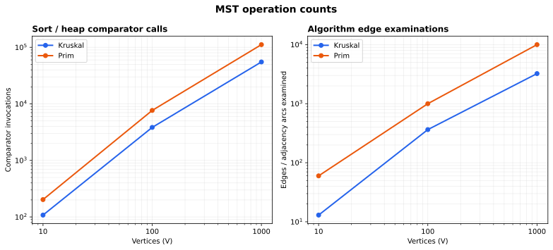
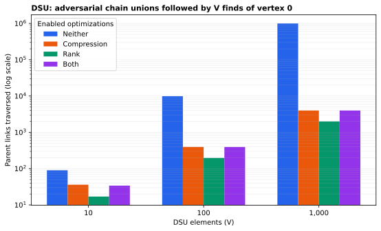

# Assignment 3 — Smart City Infrastructure and Route Planning

## Overview

This Java application represents city districts as vertices and roads or infrastructure links as weighted edges. It supports three planning tasks: selecting a minimum-cost infrastructure network, analyzing directed connectivity and service dependencies, and finding shortest travel routes from a selected district.

The graph uses an adjacency list and a separate edge list. Vertices have integer IDs from `0` to `V - 1`. Each undirected road appears once in the edge list and twice in adjacency lists; a directed road has one adjacency entry. Thus `E` always counts logical edges, not the two directions of an undirected road. Storage is O(V + E). The graph supports parallel edges, self-loops, equal weights, and isolated vertices. Benchmark generators produce simple graphs without parallel edges or self-loops.

Construction cost and travel distance have different meanings. Planners use separate graph instances for these objectives. The demo uses construction costs in arbitrary cost units and travel distances in kilometres. Its district names are Central, University, Hospital, Airport, Industrial, and Suburb.

## Implementation

| Package / file | Responsibility |
| --- | --- |
| `src/graph/` | Graph, edges, input parser, fixed-seed generators, and operation counters |
| `src/dsu/DisjointSetUnion.java` | Iterative find with full path compression and union by rank |
| `src/mst/` | Kruskal, priority-queue Prim, and immutable MST/forest results |
| `src/connectivity/` | Kahn's topological ordering and iterative Kosaraju SCC |
| `src/shortestpath/Dijkstra.java` | Priority-queue shortest distances and predecessor paths |
| `src/benchmark/Benchmark.java` | Warmups, five timed runs, validation, CSV export, and DSU comparisons |
| `src/app/Main.java` | Named city demonstration and commands for custom graph files |
| `tests/CorrectnessTests.java` | Known-answer, boundary, random, and independent-oracle checks |
| `scripts/` | Reproducible plots and this report generated from recorded results |

### Minimum spanning trees and DSU

Kruskal sorts a copy of the edge list by weight, then checks edges in increasing order. DSU accepts an edge only if its endpoints are in different components. It stops after selecting `V - 1` edges or exhausting the edges. An accepted edge cannot create a cycle; the cut property explains why the cheapest eligible connections produce a minimum spanning tree.

DSU stores parent and rank arrays. `find` first locates the root, then redirects every vertex on the searched path to that root. `union` attaches the root of smaller rank under the larger-rank root; equal ranks increase the surviving root's rank by one. A successful union reduces the number of components. Iterative find avoids recursive stack overflow.

Prim starts from an unvisited vertex and places outgoing candidate edges in a Java `PriorityQueue`. It repeatedly selects the cheapest candidate whose destination is still unvisited. Edges to already visited destinations become stale and are skipped. The cut property again guarantees the minimum total weight. If the queue empties while vertices remain unvisited, it starts another component. This is a lazy edge-based heap implementation: it may retain O(E) candidates.

Both algorithms return selected edges, a `long` total weight, and the component count. On a connected graph they return an MST. On a disconnected graph they explicitly report disconnection and return a minimum spanning forest. One vertex with no edges is connected and has MST weight zero. Equal weights can produce different edge sets with the same optimal weight; tests compare weights and spanning properties rather than demanding identical edge sets. Negative weights are valid for MST tasks.

### Directed connectivity

Topological ordering uses Kahn's algorithm: compute indegrees, enqueue zero-indegree vertices, remove them, and decrement outgoing neighbours' indegrees. If exactly V vertices are removed, every directed edge points forward in the resulting order. Otherwise at least one cycle prevents a full ordering. For a cyclic graph the application returns `dag=false` and an empty order, rather than presenting a partial order as a valid solution.

Kosaraju first performs iterative DFS to record finishing order, then constructs the transpose graph and traverses it in reverse finishing order. Each traversal in the second pass identifies one SCC. A vertex is marked when it is pushed, so it cannot enter two components. The algorithm uses explicit stacks and handles long chains without recursive DFS limits. A DAG has one singleton SCC per vertex; a self-loop is a cycle but still belongs to a singleton SCC.

### Shortest paths

Dijkstra initializes the selected source to zero and other distances to `Long.MAX_VALUE`, used as infinity. A priority queue processes the smallest distance first. A better distance updates the predecessor and inserts a new state; stale queue states are skipped. The result exposes reachability, distance, and a reconstructed path for each vertex. Unreachable vertices have an empty path and are printed as `unreachable`. Zero-weight edges are allowed. Distances and MST totals use `long` so values can exceed the 32-bit integer range.

Dijkstra validates every logical edge and rejects any negative weight, including an edge in an unreachable component. Its greedy guarantee requires non-negative weights: after the smallest tentative distance is chosen, a later route cannot reduce it. For example, with `S -> A = 2`, `S -> B = 5`, and `B -> A = -10`, the standard greedy finalization would settle A at 2 even though its shortest distance is -5. Negative edges invalidate that proof and the usual runtime guarantee. Bellman-Ford is an appropriate alternative when negative edges are necessary; a reachable negative cycle means no finite shortest distance exists for affected vertices.

### Build, run, and reproduce

Requirements: Java 17 or newer. The Java application and tests have no external dependencies. Python 3 with the packages in `requirements.txt` is needed only to recreate plots. The report-generation script itself uses the Python standard library.

From the repository root, use macOS, Linux, or Git Bash:

```bash
cd assignment-3
bash build.sh
java -cp out tests.CorrectnessTests
java -cp out app.Main demo
java -cp out app.Main mst examples/roads.txt
java -cp out app.Main connectivity examples/dependencies.txt
java -cp out app.Main connectivity examples/one-way-roads.txt
java -cp out app.Main routes examples/roads.txt 0
python3 -m pip install -r requirements.txt
bash reproduce.sh
```

From the repository root in Windows PowerShell:

```powershell
cd assignment-3
powershell -ExecutionPolicy Bypass -File build.ps1
java -cp out tests.CorrectnessTests
java -cp out app.Main demo
python -m pip install -r requirements.txt
powershell -ExecutionPolicy Bypass -File reproduce.ps1
```

Compilation uses `--release 17 -Xlint:all`. `reproduce.sh` and `reproduce.ps1` rebuild, run all tests, save the demo, run experiments, create plots, and refresh both README reports. Use `java -cp out benchmark.Benchmark` to rerun only the Java experiments. The same seed reproduces graph edges, weights, and operation counts; wall-clock timings will vary between runs and machines. Plotting and file output are outside the measured algorithm intervals.

For a custom graph file, the first line is `V E directed` or `V E undirected`, followed by exactly E lines containing `from to weight`. For example:

```text
4 4 directed
0 1 2
0 2 5
1 3 3
2 3 1
```

Run `java -cp out app.Main routes YOUR_FILE 0` to select source 0, or supply another vertex ID. Use `mst YOUR_FILE` for undirected infrastructure and `connectivity YOUR_FILE` for directed roads or dependencies. Invalid graph types, endpoints, and negative route weights are rejected.

## Complexity Analysis

Let V be the number of vertices and E the number of logical edges. Bounds use adjacency lists, Java comparison sorting, and Java's binary-heap `PriorityQueue`. Space below is additional algorithm space, including returned results but excluding the already stored input graph. Use `log(2 + E)` to cover graphs with no edges.

| Algorithm | Time complexity for this implementation | Additional space |
| --- | --- | --- |
| DSU initialization | O(V) | O(V) |
| DSU find, compression + rank | O(alpha(V)) amortized; O(log V) worst case for one call | O(1) per call beyond DSU arrays |
| DSU union, compression + rank | Two finds plus O(1); O(alpha(V)) amortized | O(1) per call beyond DSU arrays |
| Kruskal | O(V + E log(2 + E) + E alpha(V)) | O(V + E) |
| Prim, lazy edge heap | O(V + E log(2 + E)) | O(V + E) |
| Kosaraju SCC | O(V + E) | O(V + E), including transpose |
| Kahn topological ordering | O(V + E) | O(V) |
| Dijkstra, lazy state heap | O(V + E log(2 + E)) | O(V + E) |

`alpha(V)` is the inverse Ackermann function and grows extremely slowly. For m DSU operations with initialization, the combined bound is O(V + m alpha(V)). Rank alone bounds tree height by O(log V). Without either optimization, an adversarial sequence can create height V - 1 and a find can cost O(V). Compression alone shortens previously searched paths; compression plus rank gives the general amortized guarantee.

Kruskal pays to sort all E edges even if it stops checking candidates early. More vertices enlarge its DSU arrays; more edges increase sort work. Prim scans each adjacency arc and may insert and remove O(E) edges, including stale candidates. On simple graphs, E <= V(V - 1)/2, so `log E = O(log V)` and the usual O(E log V) connected-graph description follows. The O(E)-sized heap is why its additional space is not merely O(V).

Kosaraju's two traversals and transpose construction are linear in V + E. Kahn examines every edge to build indegrees, then examines outgoing edges of removed vertices. Cycles can reduce the second pass, but worst-case time remains O(V + E). More edges increase both algorithms' linear work; more vertices increase traversal and array work.

Dijkstra validates E logical weights and then examines outgoing arcs of reachable vertices. Non-negative weights allow each reachable vertex to be expanded once. Each successful relaxation creates one heap state, so the lazy queue can contain O(E) states. On simple connected graphs this becomes the familiar O((V + E) log V) bound. Initial arrays still cost O(V), even when many vertices are unreachable. Reconstructing one path takes O(path length); printing paths for all vertices can require O(V squared) total output in a long chain. Path reconstruction and printing are excluded from shortest-distance benchmarks.

## Experimental Setup

| Configuration | Vertices V | Edges E |
| --- | --- | --- |
| Small | 10 | 30 |
| Medium | 100 | 500 |
| Large | 1,000 | 5,000 |

The base seed is **20261014**, using `java.util.Random`. For each size, the undirected graph uses `base + V`, the DAG uses `base + V + 1`, and the cyclic graph uses `base + V + 2`. Weights are uniformly drawn integers from 1 to 100. Duplicate weights are intentional. Generators reject duplicate endpoint pairs and self-loops, retain a deterministic insertion order, and generate exactly E edges.

The undirected generator first joins every vertex i > 0 to a randomly chosen vertex in `[0, i)`, forming a spanning tree. It then adds random distinct undirected edges until the target E is reached. This guarantees connectivity. Kruskal, Prim, and Dijkstra use this same graph; Dijkstra's source is vertex 0.

The DAG generator first adds the chain `0 -> 1 -> ... -> V - 1`. Additional random edges always point from the smaller ID to the larger ID. Consequently it has no cycles and all vertices are reachable from 0. The natural increasing order is valid, although tests validate any returned order by checking all edges.

The cyclic generator partitions vertices into consecutive blocks of five. Each block starts with a directed ring. Extra edges are allowed within a block or from a lower-numbered block to a higher-numbered block. There are exactly V / 5 SCCs, each containing five vertices. Every vertex has positive indegree from its ring, so Kahn's queue starts empty and detects a cycle after the indegree pass. This is a deliberately documented cyclic workload; it does not represent every possible cyclic graph.

All seven algorithm/type combinations run at every size: Kruskal, Prim, Dijkstra, Kosaraju on DAG and cyclic graphs, and topological ordering on DAG and cyclic graphs. Generated connectivity, MST weight agreement, DAG status, and known cyclic SCC counts are checked before measurement.

Each graph is generated once outside the timer. Each case has 200 unmeasured warmup invocations, followed by exactly five measured invocations in one JVM. The measured loop rotates its starting case to reduce a fixed ordering effect. Each invocation uses fresh algorithm arrays, heaps, results, and counters; input graphs are shared read-only. The interval is `System.nanoTime()` immediately before and after the algorithm call. A volatile sink consumes results outside that interval. DSU tests also use 200 warmups and five measurements per variant and size.

Recorded averages are arithmetic means of five elapsed times. Sample standard deviation divides the squared-deviation sum by four. Raw timings, minimums, maximums, and deterministic operation counts are retained. The benchmark checks that graph-algorithm counters match between repetitions. Instrumentation is included in timings, so these are measurements of the supplied instrumented implementations.

### Environment

```text
Java: 17.0.20+8-1-24.04-Ubuntu
VM: OpenJDK 64-Bit Server VM
OS: Linux amd64
Available processors: 8
Base seed: 20261014
Warmup invocations per case: 200
Measured invocations per case: 5
Timer: System.nanoTime()
```

## Results

### Execution times

Times are in **microseconds**, converted from nanoseconds by dividing by 1,000. Each cell is the mean of five measured runs.

| Algorithm / graph | Small: V=10, E=30 | Medium: V=100, E=500 | Large: V=1,000, E=5,000 |
| --- | --- | --- | --- |
| Kruskal | 11.968 | 1730.565 | 857.730 |
| Prim | 14.632 | 122.877 | 1930.098 |
| Kosaraju (DAG) | 7.482 | 44.893 | 7947.304 |
| Kosaraju (Cyclic) | 4.168 | 39.798 | 472.798 |
| Topological (DAG) | 2.935 | 6.710 | 117.714 |
| Topological (Cyclic) | 1.009 | 1.404 | 12.399 |
| Dijkstra | 24.038 | 147.293 | 3349.074 |

The following table makes timing variation visible. SD is the sample standard deviation; median, minimum, and maximum come from the same five runs. No outliers were removed.

| Algorithm / graph | V | SD (µs) | Median (µs) | Min (µs) | Max (µs) |
| --- | --- | --- | --- | --- | --- |
| Kruskal | 10 | 2.794 | 12.088 | 8.703 | 15.503 |
| Prim | 10 | 8.750 | 12.789 | 3.936 | 27.892 |
| Kosaraju (DAG) | 10 | 6.491 | 5.048 | 3.716 | 18.989 |
| Kosaraju (Cyclic) | 10 | 1.782 | 3.415 | 2.904 | 7.291 |
| Topological (DAG) | 10 | 2.920 | 1.513 | 1.021 | 7.922 |
| Topological (Cyclic) | 10 | 0.734 | 0.631 | 0.410 | 2.173 |
| Dijkstra | 10 | 5.499 | 26.480 | 18.108 | 30.055 |
| Kruskal | 100 | 3605.316 | 123.727 | 105.039 | 8179.929 |
| Prim | 100 | 15.507 | 119.190 | 103.536 | 142.956 |
| Kosaraju (DAG) | 100 | 18.375 | 33.590 | 31.026 | 72.199 |
| Kosaraju (Cyclic) | 100 | 12.899 | 33.410 | 30.777 | 62.103 |
| Topological (DAG) | 100 | 0.609 | 6.429 | 6.259 | 7.761 |
| Topological (Cyclic) | 100 | 0.357 | 1.382 | 0.911 | 1.813 |
| Dijkstra | 100 | 27.493 | 135.314 | 126.782 | 193.633 |
| Kruskal | 1000 | 81.299 | 834.460 | 771.246 | 957.506 |
| Prim | 1000 | 1896.734 | 1150.598 | 951.948 | 5319.497 |
| Kosaraju (DAG) | 1000 | 12746.818 | 744.125 | 288.856 | 29893.116 |
| Kosaraju (Cyclic) | 1000 | 182.202 | 460.726 | 321.035 | 773.178 |
| Topological (DAG) | 1000 | 102.753 | 72.600 | 63.245 | 301.055 |
| Topological (Cyclic) | 1000 | 2.191 | 12.129 | 9.594 | 14.833 |
| Dijkstra | 1000 | 3547.133 | 1346.725 | 747.719 | 8897.824 |

### Kruskal versus Prim operation counts

| Algorithm | V | E | Edges examined | Comparator calls | Finds | Unions | Heap pushes | Heap pops |
| --- | --- | --- | --- | --- | --- | --- | --- | --- |
| Kruskal | 10 | 30 | 13 | 108 | 26 | 13 | 0 | 0 |
| Prim | 10 | 30 | 60 | 203 | 0 | 0 | 30 | 30 |
| Kruskal | 100 | 500 | 364 | 3838 | 728 | 364 | 0 | 0 |
| Prim | 100 | 500 | 1000 | 7665 | 0 | 0 | 500 | 500 |
| Kruskal | 1000 | 5000 | 3233 | 55182 | 6466 | 3233 | 0 | 0 |
| Prim | 1000 | 5000 | 10000 | 111680 | 0 | 0 | 5000 | 5000 |

Kruskal's `edges` column counts sorted candidates examined after sorting. Its comparator column records sort-comparator invocations. Prim's `edges` column counts adjacency arcs, including both directions of each undirected road, and its comparator column records heap-comparator invocations. These counters describe different work and should not be added into a universal operation score. Full parent-hop/write and vertex-visit counts are included in the CSV.

### SCC and topological operation counts

| Algorithm / graph | V | E | Edges examined | Vertex visits | Outcome / SCC count |
| --- | --- | --- | --- | --- | --- |
| Kosaraju (DAG) | 10 | 30 | 90 | 20 | 10 |
| Kosaraju (Cyclic) | 10 | 30 | 90 | 20 | 2 |
| Topological (DAG) | 10 | 30 | 60 | 10 | Valid DAG order |
| Topological (Cyclic) | 10 | 30 | 30 | 0 | Cycle detected |
| Kosaraju (DAG) | 100 | 500 | 1500 | 200 | 100 |
| Kosaraju (Cyclic) | 100 | 500 | 1500 | 200 | 20 |
| Topological (DAG) | 100 | 500 | 1000 | 100 | Valid DAG order |
| Topological (Cyclic) | 100 | 500 | 500 | 0 | Cycle detected |
| Kosaraju (DAG) | 1000 | 5000 | 15000 | 2000 | 1000 |
| Kosaraju (Cyclic) | 1000 | 5000 | 15000 | 2000 | 200 |
| Topological (DAG) | 1000 | 5000 | 10000 | 1000 | Valid DAG order |
| Topological (Cyclic) | 1000 | 5000 | 5000 | 0 | Cycle detected |

Kosaraju examines exactly 3E edges/arcs: E in the first DFS, E while building the transpose, and E in the second DFS. It visits vertices twice, giving 2V visits. Kahn examines 2E edges on these DAGs; on these cyclic graphs it examines E during indegree construction and removes no vertices. DAG SCC counts are V; cyclic SCC counts are V / 5.

### Dijkstra operation counts

| V | E | Edges examined | Heap comparisons | Relaxations | Heap pushes | Heap pops | Vertex visits |
| --- | --- | --- | --- | --- | --- | --- | --- |
| 10 | 30 | 90 | 76 | 16 | 17 | 17 | 10 |
| 100 | 500 | 1500 | 2060 | 178 | 179 | 179 | 100 |
| 1000 | 5000 | 15000 | 35402 | 1918 | 1919 | 1919 | 1000 |

All benchmark vertices are reachable. Dijkstra's examinations include E weight-validation checks plus 2E undirected adjacency arcs, giving 3E. Only successful distance improvements count as `relaxations`. Each such improvement inserts one state, plus the initial source state; the queue is drained, so pushes equal pops. Heap comparisons count comparator invocations, including stale-state processing.

### DSU optimization experiment

For every size and variant, run `union(i, i - 1)` for i = 1 through V - 1, followed by V calls to `find(0)`. Without rank, these unions build a deep chain. There are V - 1 union calls and 3V - 2 total find calls, including the two finds inside every union. This deterministic workload isolates repeated searches after adversarial unions.

| Optimizations | V | Mean (µs) | SD (µs) | Parent hops | Parent writes |
| --- | --- | --- | --- | --- | --- |
| Neither | 10 | 5.999 | 0.382 | 90 | 9 |
| Compression | 10 | 8.751 | 7.770 | 36 | 17 |
| Rank | 10 | 4.529 | 0.186 | 17 | 9 |
| Both | 10 | 0.379 | 0.043 | 34 | 9 |
| Neither | 100 | 15.143 | 0.131 | 9900 | 99 |
| Compression | 100 | 2.570 | 0.153 | 396 | 197 |
| Rank | 100 | 1.791 | 0.105 | 197 | 99 |
| Both | 100 | 2.021 | 0.076 | 394 | 99 |
| Neither | 1000 | 6724.919 | 6950.677 | 999000 | 999 |
| Compression | 1000 | 12.870 | 0.208 | 3996 | 1997 |
| Rank | 1000 | 8.930 | 0.186 | 1997 | 999 |
| Both | 1000 | 11.233 | 0.184 | 3994 | 999 |

A parent hop counts one traversed link. Compression's second pass also counts its link traversals; `parent_writes` counts actual parent changes, not initialization. Rank only can therefore have fewer measured hops than both optimizations in an already shallow tree. This does not contradict the general combined amortized bound.

### Plots





Both required plots use logarithmic axes to show the complete range. They plot the same three graph configurations against different x-axes. Because V and E increase together, they do not independently establish the causal effect of changing only V or only E. Lines connect observed means and are not fitted complexity curves; timing uncertainty is documented in the table above.





Data: [raw graph runs](results/tables/raw_runs.csv), [graph summary](results/tables/summary.csv), [raw DSU runs](results/tables/dsu_raw_runs.csv), [DSU summary](results/tables/dsu_summary.csv), [test output](results/tables/tests.txt), and [demo output](results/tables/demo.txt). PNG versions of every plot are also available in `results/plots/`.

## Comparison and Discussion

For the large graph, Kruskal's mean was 857.730 microseconds and Prim's was 1930.098 microseconds. Kruskal used 55182 sort comparisons, 3233 candidate examinations, and 3233 union calls. Prim used 111680 heap comparisons, scanned 10000 adjacency arcs, and pushed/popped 5000 candidates. Their correctness checks agree on the minimum total weight for all connected test graphs.

As cyclic SCC inputs grew from 10/30 to 100/500 to 1,000/5,000, mean times were 4.168, 39.798, 472.798 microseconds. Edge examinations grew from 90 to 1,500 to 15,000, exactly matching the linear 3E traversal count. The recorded DAG SCC times show greater timing variation, rather than a different theoretical complexity.

Dijkstra's means across the same sizes were 24.038, 147.293, 3349.074 microseconds. Successful relaxations grew from 16 to 178 to 1918, and heap comparisons grew from 76 to 2060 to 35402. Extra edges create additional route candidates, so heap work depends on actual improvements, not just on V.

At V = 1,000, unoptimized DSU traversed 999,000 parent links, compression only 3,996, rank only 1,997, and both 3,994. The combined version reduced link traversals by about 250.1 times relative to neither optimization in this workload. The benefit is demonstrated structurally; it should not be interpreted as a universal wall-clock speedup factor.

The small tests run in microseconds, where JVM compilation, allocation, garbage collection, and host scheduling can noticeably affect elapsed time even after warmup. These are possible explanations for timing variation, not measured diagnoses. In particular, the non-monotonic Kruskal mean and the large Kosaraju DAG mean must be read with their five-run distribution. Deterministic operation counts provide stronger evidence about algorithmic growth than a single noisy mean. Five repetitions satisfy this assignment but do not establish a general performance ranking. A broader study would use more seeds, independent JVM forks, and graph families that vary V and E separately.

Kruskal sorts every edge, whereas this lazy Prim processes many heap candidates that later become stale. On these sparse connected graphs, Kruskal's large-case comparator count is lower than Prim's. An indexed heap could reduce Prim's live queue to O(V), but that is a different implementation with different constants. Dense graphs may also favour other Prim variants; the current experiment does not test dense matrices.

Both Kosaraju workloads perform the same 3E examinations and 2V visits, although finishing-order shape, allocation, and runtime variation can change their measured times. The cyclic workloads return fewer component lists than DAGs. Kahn's cyclic cases are faster here because every vertex is blocked from the start. A graph with a small cycle and a large removable acyclic region would do more second-pass work; cycle detection is still O(V + E) in the worst case.

DSU path compression helps subsequent searches reuse a flattened path, while rank prevents tall trees from being formed. The adversarial chain experiment makes both effects visible. Rank only is especially favourable for this particular sequence because it creates a shallow star. The combined implementation is used in Kruskal for its robust amortized guarantee across mixed workloads. DSU timings at very small sizes are also sensitive to warmup and variant ordering, so the parent-hop comparison is the clearer structural result.

## Testing

The test runner uses explicit checks that throw `AssertionError`, so correctness checks run even without Java's `-ea` option. The recorded final result is:

```text
PASS: 14 suites, 18371 correctness checks
```

| Test family | Correctness evidence |
| --- | --- |
| DSU | Successful and redundant unions; component counts; transitive connectivity; rank behaviour; a depth-two path actually compressed |
| Small graphs | Known MST weight 6; known distances 0, 3, 1, 4, 4; known predecessor path |
| Disconnected graphs | Three-component forest weight 7; entirely edgeless graph; isolated districts |
| Cycles | Directed cycle rejection; singleton self-loop; several SCCs connected by one-way edges |
| Multiple valid MSTs | Equal-weight four-vertex graph; optimal weight 3 without requiring the same edge set |
| Unreachable vertices | Infinity and empty path; disconnected source; negative edge in an unreachable component rejected |
| Duplicate weights and parallel edges | Correct MST and shortest paths with tied and repeated edges |
| Single vertex | Connected MST weight zero; order [0]; one SCC; distance zero and path [0] |
| Numeric and input boundaries | MST/route totals 4,294,967,294; negative route weights; invalid IDs/types; graph-file parsing |
| Required graph sizes | Exact V/E; fixed-seed reproducibility; connectivity; MST agreement; DAG order; cyclic five-vertex SCCs |
| 100 seeded undirected cases | Exhaustive enumeration of candidate spanning trees independently checks optimal MST weights; Floyd-Warshall checks distances |
| 100 seeded directed cases | Transitive closure independently checks cycle detection and SCC equivalence; Floyd-Warshall checks every source |
| 20,000-vertex chain | Iterative SCC does not overflow the call stack; DAG and end-to-end distance checks |

Each selected MST/forest is also checked for valid input edges, the correct total, no cycles, the expected component count, and exactly V - components edges. Topological tests check every vertex exactly once and every edge pointing forward. SCC tests check that every vertex appears exactly once and that two vertices share a component exactly when they are mutually reachable. Dijkstra tests compare distances to Floyd-Warshall and independently sum the edges in each reported path.

### City demonstration

Both MST algorithms return total construction cost **130** for the demo's connected infrastructure graph. Travel roads leave Suburb isolated:

| Destination from Central | Distance (km) | Shortest route |
| --- | --- | --- |
| Central | 0 | Central |
| University | 3 | Central → Hospital → University |
| Hospital | 2 | Central → Hospital |
| Airport | 8 | Central → Hospital → University → Airport |
| Industrial | 10 | Central → Hospital → University → Airport → Industrial |
| Suburb | Unreachable | No route |

The service dependency DAG returns `[0, 5, 1, 2, 3, 4]`. Adding `4 -> 2` creates the SCC `{2, 3, 4}` and makes topological ordering impossible. Vertex 5 remains an independent SCC.

## Conclusion

The application implements all required algorithms and connects their outputs to smart-city planning. Kruskal or Prim finds the minimum-cost undirected infrastructure network; disconnected districts are identified explicitly. Optimized DSU makes Kruskal's repeated connectivity checks efficient. Kahn's ordering schedules acyclic service dependencies and detects cyclic dependencies. Kosaraju groups locations that can reach one another through directed roads. Dijkstra finds efficient routes from a chosen source when distances are non-negative and identifies districts without a route.

For these graph sizes, operation growth matches sorting/heap work for MST and shortest paths and linear traversal work for SCC and topological ordering. Timing variation prevents a universal winner from being inferred from five samples. Algorithm selection should follow the planning task, graph representation, edge-weight restrictions, and connectivity needs.

## Grading Criteria Checklist

| Criterion | Points | Evidence |
| --- | --- | --- |
| DSU | 10 | Compression, union by rank, counters, optimization experiment, and tests |
| Kruskal and Prim | 20 | Both implementations, total weights, connectivity/forest handling, and comparison |
| SCC and topological ordering | 15 | Iterative Kosaraju, Kahn, DAG and cyclic experiments, and independent checks |
| Dijkstra | 15 | Selected source, distances, paths, unreachable handling, non-negative validation, and explanation |
| Complexity analysis | 10 | Implementation-specific time/space bounds, assumptions, and V/E effects |
| Experimental design and benchmarking | 10 | Exact required sizes, documented generators, fixed seeds, five runs, nanoTime, and counters |
| Results, plots, and discussion | 10 | Actual tables, raw data, four plots, interpretation, and variability |
| Testing and correctness | 5 | All required edge cases, independent oracles, and recorded output |
| README and GitHub quality | 5 | Complete report, organized packages, reproduction scripts, and meaningful development commits |
| Total criteria addressed | 100 | All deliverables are included; the final grade is determined by the instructor |
